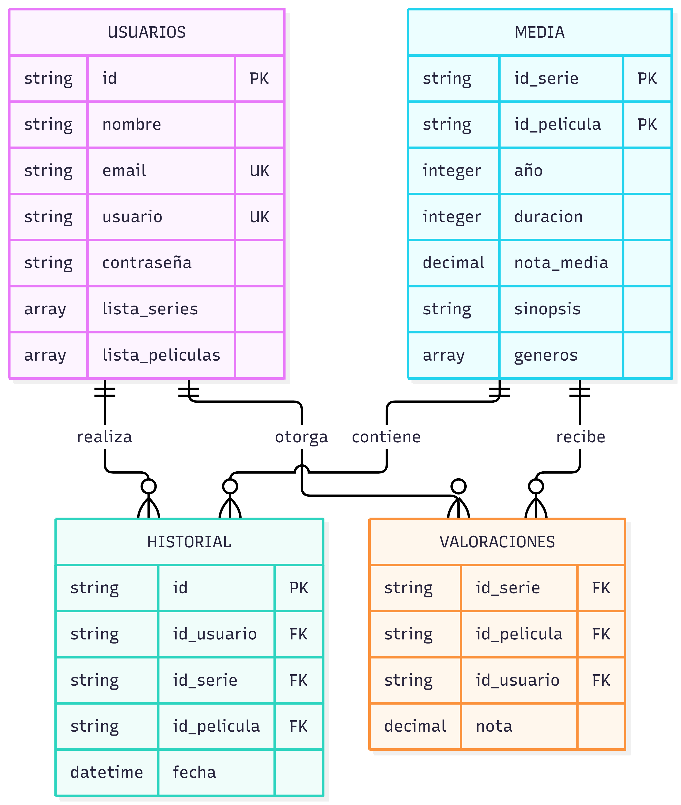

## 2. Diseñar las colecciones.

Imagen del diagrama:



### 1. Colecciones de datos y sus propósitos.
Usuarios: Almacena el perfil del usuario, credenciales seguras, datos anonimizados para cumplir con RGPD, sus listas directas de marcadores (favoritos/"Mi Lista") y preferencias estáticas.

Media: Catálogo único polimórfico de títulos (películas y series). Contiene la metadata descriptiva (géneros, sinopsis, duración/temporadas) y agregaciones precalculadas (nota_media, total_votos) optimizadas para lecturas de alta concurrencia.

Historial: Almacena el log de eventos de consumo cronológico por usuario (reproducciones completas o parciales), desacoplado del documento del usuario para permitir un crecimiento ilimitado en series temporales.

Valoraciones: Registro transaccional de calificaciones numéricas y reseñas individuales asociadas a un par (usuario, media). Permite lecturas filtradas por título o autor sin penalizar el tamaño del catálogo.
### 2. Documentos JSON de las colecciones.

JSON de usuarios:
```json
{
  "_id": {"$oid": "651a1b2c3d4e5f6a7b8c9d01"},
  "pseudonimo_id": "usr_94f8a12e",
  "nombre": "Elena García",
  "usuario": "elena_cine",
  "email": "elena.garcia@example.com",
  "password_hash": "$2b$12$e8Y0N...hashedpassword",
  "estado": "ACTIVO",
  "mi_lista": [
    {"media_id": {"$oid": "651a1b2c3d4e5f6a7b8c9d10"}, "tipo": "PELICULA", "añadido_en": {"$date": "2026-02-14T20:00:00Z"}},
    {"media_id": {"$oid": "651a1b2c3d4e5f6a7b8c9d20"}, "tipo": "SERIE", "añadido_en": {"$date": "2026-03-01T10:15:00Z"}}
  ],
  "preferencias_generos": ["Ciencia Ficción", "Drama"],
  "fecha_registro": {"$date": "2026-01-10T08:30:00Z"},
  "fecha_baja": null
}
```

JSON de media:
```json
{
  "_id": {"$oid": "651a1b2c3d4e5f6a7b8c9d20"},
  "tipo": "SERIE",
  "titulo": "Horizonte Cuántico",
  "sinopsis": "Un grupo de científicos descubre una anomalía gravitatoria.",
  "anio_lanzamiento": 2025,
  "generos": ["Ciencia Ficción", "Suspense"],
  "estado": "PUBLICADO",
  "nota_media": 8.7,
  "total_votos": 1420,
  "temporadas": [
    {
      "numero": 1,
      "episodios": [
        {"numero": 1, "titulo": "Punto de Inflexión", "duracion_min": 52},
        {"numero": 2, "titulo": "Entropía", "duracion_min": 48}
      ]
    }
  ],
  "duracion_min": null,
  "creado_en": {"$date": "2025-11-20T12:00:00Z"}
}
```

JSON de historial:
```json
{
  "_id": {"$oid": "651a1b2c3d4e5f6a7b8c9d30"},
  "usuario_id": {"$oid": "651a1b2c3d4e5f6a7b8c9d01"},
  "media_id": {"$oid": "651a1b2c3d4e5f6a7b8c9d20"},
  "tipo": "SERIE",
  "temporada": 1,
  "episodio": 2,
  "segundos_vistos": 2880,
  "completado": true,
  "fecha_visualizacion": {"$date": "2026-09-28T22:15:30Z"}
}
```

JSON de valoraciones:
```json
{
  "_id": {"$oid": "651a1b2c3d4e5f6a7b8c9d40"},
  "media_id": {"$oid": "651a1b2c3d4e5f6a7b8c9d10"},
  "usuario_id": {"$oid": "651a1b2c3d4e5f6a7b8c9d01"},
  "nota": 9.0,
  "comentario": "Excelente ritmo y banda sonora imponente.",
  "estado": "VISIBLE", 
  "fecha_creacion": {"$date": "2026-09-29T14:20:00Z"}
}
```
### 3. Modelo de incrustación y de referencia.

1- Variantes de películas y series (Incrustación):
El usuario entra en la plataforma y el selector desplegable debe saber que películas y series son las opciones disponibles.

2- Valoraciones (Referencia):
Los usuarios pueden poner reseñas a muchas series y películas, por lo que no es necesario guardar todas dentro de un documento.

### 4. Estrategia para identificadores, fechas, estados y campos opcionales.

Identificadores: id_usuario, id_media, id_valoraciones
Fechas: fecha_valoracion, fecha_creacion, fecha_visualizacion
Estados: String de "pendiente", "vista", "en proceso".
Campos opcionales: El campo "comentario" es opcional para valoraciones.

### 5. Límites del modelo.

Evitar arrays infinitos en las valoraciones a las series y películas.
Controlar el tamaño de los campos de texto.