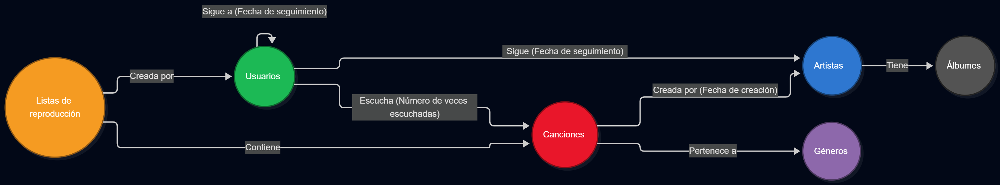

## 2. Diseñar el grafo de nodos y relaciones.




### 1. Etiquetas de nodos.
```js
Usuario{
    id_usuario,
    nombre,
    email,
}
Cancion{
    id_cancion,
    titulo,
    duracion,
    fecha_creacion,
    reproducciones_totales
}
Artista{
    id_artista,
    nombre,
    oyentes_mensuales,
    pais_origen
}
Género{
    id_genero,
    nombre
}
Lista de reproducción{
    id_lista,
    nombre,
}
Album{
    id_album,
    titulo,
    lanzamiento
}
```

### 2. Relaciones de nodos

1. Usuarios -> Sigue -> Artistas. (Fecha de seguimiento)
2. Usuarios -> Escucha -> Canciones (Número de veces escuchadas)
3. Canciones -> Creada por -> Artistas (Fecha de creación)
4. Canciones -> Pertenece a -> Géneros
5. Listas de reproducción -> Creada por -> Usuarios
6. Listas de reproducción -> Contiene -> Canciones
7. Artistas -> Tiene -> Álbumes
8. Usuarios -> Sigue a -> Usuarios (Fecha de seguimiento)
9. Cancion -> Parte de -> Album

### 3. Justificación frente a SQL.
Cada elemento en el grafo se modela como un nodo ya que facilita la velocidad de las consultas en referencia a modelos de bases de datos relacionales, que son más lentas que las de grafos.

Por ejemplo, una consulta de las recomendaciones de un usuario con respecto a las listas de reproducción de sus amigos tienes que hacer una consulta a la base de datos en SQL con un JOIN a diferentes tablas, sin embargo en un grafo de nodos y relaciones, la consulta es más directa.

### 4. Estrategia de identificadores únicos.

Identificadores unívocos: Los identificadores de los nodos son únicos y legibles.

Propiedades en las relaciones: Algunas relaciones tienen propiedades que evitan crear tablas y colecciones intermedias.


### 5. Límites y riesgos del modelo.

Profundidad de saltos ilimitada: Ejecutar exploraciones abiertas sin especificar un límite de niveles.

Búsquedas globales: Buscar patrones abstractos en el grafo sin un punto de partida concreto.